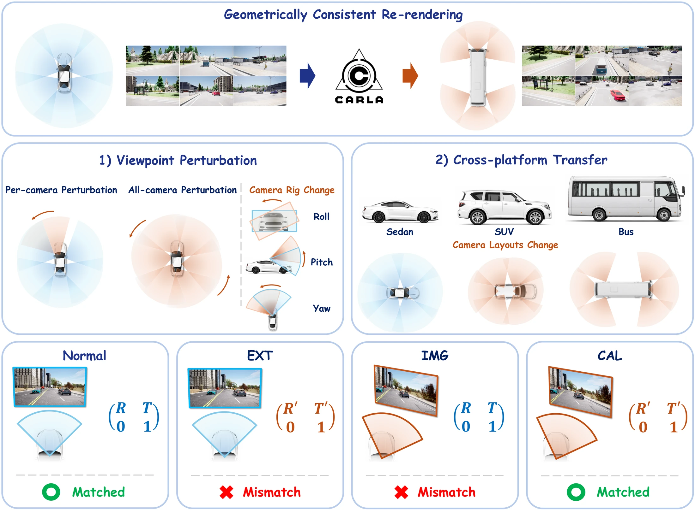

<p align="center">
  
</p>

<h1 align="center">RoboGeo</h1>

<p align="center">
  <b>Benchmarking Camera-Geometry Robustness in Multi-Camera BEV Perception</b><br>
  WACV 2027 · Evaluations &amp; Datasets Track
</p>

<p align="center">
  <a href="https://robogeo2027.github.io/">Project page</a> ·
  <a href="https://huggingface.co/datasets/shdragron/RoboGeo">Dataset</a> ·
  <a href="https://huggingface.co/shdragron/RoboGeo-checkpoints">Checkpoints</a>
</p>

## Benchmark

<p align="center">
  
</p>

RoboGeo re-renders the same driving scenes in CARLA under changed camera geometries and provides
two protocols:

- **Viewpoint perturbation** rotates one camera or all six cameras of the base rig about roll,
  pitch or yaw by ±4° to ±20°.
- **Cross-platform transfer** deploys Sedan-trained models on the SUV and Bus camera layouts.

Each protocol is evaluated under four conditions: NORMAL (base images, base extrinsics),
EXT (base images, changed extrinsics), IMG (changed images, base extrinsics) and CAL (changed images,
corresponding extrinsics).

Task performance $P$ is the CARLA Detection Score (CDS) for 3D object detection and the vehicle IoU
for BEV segmentation. Robustness is reported as

$$
\mathrm{mVRS}_c = \frac{1}{|M|}\sum_{m\in M}\frac{1}{|G|}\sum_{(a,\theta)\in G}\frac{P^{(m,a,\theta)}_c}{P_{\mathrm{NORMAL}}},
\qquad
\mathrm{CTS}^{(r)}_c = \frac{P^{(r)}_c}{P^{(r)}_{\mathrm{oracle}}},
$$

where $M$ is the six single cameras plus all cameras, $G$ is the perturbation grid, and
$P^{(r)}_{\mathrm{oracle}}$ is a model trained and evaluated on platform $r$.

## Results

Higher is better. P<sub>NORMAL</sub> and P<sub>oracle</sub> are CDS for detection and IoU for segmentation.
IMG is the primary condition of viewpoint perturbation and CAL that of cross-platform transfer (best in bold).

<table>
<thead>
<tr><th rowspan="3">Model</th><th colspan="4">Viewpoint perturbation: mVRS (%)</th><th colspan="6">Cross-platform transfer: CTS (%)</th></tr>
<tr><th colspan="4">Sedan</th><th colspan="3">SUV</th><th colspan="3">Bus</th></tr>
<tr><th>P<sub>NORMAL</sub></th><th>EXT</th><th>IMG</th><th>CAL</th><th>P<sub>oracle</sub></th><th>IMG</th><th>CAL</th><th>P<sub>oracle</sub></th><th>IMG</th><th>CAL</th></tr>
</thead>
<tbody>
<tr><th colspan="11" align="left">3D object detection (CDS)</th></tr>
<tr><td colspan="11"><i>Forward-projection</i></td></tr>
<tr><td>BEVDet†</td><td align="center">0.517</td><td align="center">89.1</td><td align="center">83.0</td><td align="center">87.5</td><td align="center">0.535</td><td align="center">17.0</td><td align="center">16.1</td><td align="center">0.373</td><td align="center">0.2</td><td align="center">22.8</td></tr>
<tr><td>BEVDepth†</td><td align="center">0.535</td><td align="center">90.2</td><td align="center">82.8</td><td align="center">87.4</td><td align="center">0.547</td><td align="center">10.3</td><td align="center">5.7</td><td align="center">0.418</td><td align="center">0.1</td><td align="center">16.6</td></tr>
<tr><td colspan="11"><i>Backward-projection</i></td></tr>
<tr><td><a href="detection/bevformer">BEVFormer</a></td><td align="center">0.504</td><td align="center">83.2</td><td align="center">83.9</td><td align="center">93.6</td><td align="center">0.503</td><td align="center">37.2</td><td align="center">71.9</td><td align="center">0.547</td><td align="center">18.0</td><td align="center">40.1</td></tr>
<tr><td>DFA3D†</td><td align="center">0.489</td><td align="center">90.5</td><td align="center"><b>86.1</b></td><td align="center">93.1</td><td align="center">0.514</td><td align="center">38.8</td><td align="center">47.5</td><td align="center">0.556</td><td align="center">28.8</td><td align="center"><b>48.1</b></td></tr>
<tr><td>DETR3D</td><td align="center">0.533</td><td align="center">84.3</td><td align="center">84.1</td><td align="center">96.0</td><td align="center">0.560</td><td align="center">34.9</td><td align="center"><b>76.9</b></td><td align="center">0.602</td><td align="center">26.5</td><td align="center">37.6</td></tr>
<tr><td colspan="11"><i>Projection-free</i></td></tr>
<tr><td><a href="detection/cape">CAPE‡</a></td><td align="center">0.555</td><td align="center">94.0</td><td align="center">83.9</td><td align="center">88.6</td><td align="center">0.596</td><td align="center">33.8</td><td align="center">34.3</td><td align="center">0.449</td><td align="center">36.0</td><td align="center">32.9</td></tr>
<tr><th colspan="11" align="left">BEV vehicle segmentation (IoU)</th></tr>
<tr><td colspan="11"><i>Forward-projection</i></td></tr>
<tr><td>LSS</td><td align="center">0.445</td><td align="center">88.4</td><td align="center">81.9</td><td align="center">86.3</td><td align="center">0.497</td><td align="center">24.3</td><td align="center">23.9</td><td align="center">0.567</td><td align="center">17.4</td><td align="center">17.1</td></tr>
<tr><td><a href="segmentation">GaussianLSS</a></td><td align="center">0.489</td><td align="center">90.7</td><td align="center"><b>84.5</b></td><td align="center">92.1</td><td align="center">0.511</td><td align="center">36.3</td><td align="center">40.9</td><td align="center">0.582</td><td align="center">14.1</td><td align="center">36.6</td></tr>
<tr><td colspan="11"><i>Backward-projection</i></td></tr>
<tr><td>BEVFormer</td><td align="center">0.455</td><td align="center">80.2</td><td align="center">79.6</td><td align="center">88.2</td><td align="center">0.473</td><td align="center">18.2</td><td align="center">23.0</td><td align="center">0.542</td><td align="center">18.8</td><td align="center"><b>36.8</b></td></tr>
<tr><td>PointBeV</td><td align="center">0.485</td><td align="center">79.7</td><td align="center">79.4</td><td align="center">92.6</td><td align="center">0.510</td><td align="center">23.2</td><td align="center"><b>67.5</b></td><td align="center">0.544</td><td align="center">10.3</td><td align="center">20.5</td></tr>
<tr><td colspan="11"><i>Projection-free</i></td></tr>
<tr><td><a href="segmentation">CVT</a></td><td align="center">0.420</td><td align="center">91.2</td><td align="center">83.8</td><td align="center">90.9</td><td align="center">0.433</td><td align="center">46.5</td><td align="center">27.1</td><td align="center">0.477</td><td align="center">17.5</td><td align="center">2.4</td></tr>
<tr><td>LaRa</td><td align="center">0.454</td><td align="center">91.1</td><td align="center">82.5</td><td align="center">90.0</td><td align="center">0.490</td><td align="center">31.0</td><td align="center">38.5</td><td align="center">0.535</td><td align="center">27.7</td><td align="center">21.5</td></tr>
<tr><td>DSPE‡</td><td align="center">0.436</td><td align="center">97.7</td><td align="center">80.7</td><td align="center">82.0</td><td align="center">0.454</td><td align="center">26.7</td><td align="center">27.1</td><td align="center">0.533</td><td align="center">14.5</td><td align="center">15.6</td></tr>
</tbody>
</table>

† trained with explicit depth supervision. ‡ designed to be robust to extrinsic viewpoint changes (EXT).

## TODO

- [x] [Dataset](https://huggingface.co/datasets/shdragron/RoboGeo): Sedan, SUV and Bus camera layouts, viewpoint perturbation images and BEV segmentation labels
- [x] Evaluation code for viewpoint perturbation (mVRS) and cross-platform transfer (CTS)
- [x] Training code for BEVFormer, CAPE, GaussianLSS and CVT
- [x] [Checkpoints](https://huggingface.co/shdragron/RoboGeo-checkpoints) of BEVFormer, CAPE, GaussianLSS and CVT for the Sedan, SUV and Bus
- [ ] Code and checkpoints of BEVDet, BEVDepth, DFA3D and DETR3D (3D object detection) and LSS, PointBeV, LaRa and DSPE (BEV segmentation)

## Getting started

1. [Installation](docs/install.md): one Docker image per model.
2. [Data and checkpoints](docs/data.md): download RoboGeo and the released checkpoints.
3. [Evaluation and training](docs/get_started.md): reproduce the results table and retrain the
   released models.
4. [Benchmarking a new model](docs/new_model.md): run both protocols on your own model.

## License

The code is released under [Apache-2.0](LICENSE). Vendored third-party code keeps its own license
(see [THIRD_PARTY_NOTICES.md](THIRD_PARTY_NOTICES.md)). GaussianLSS depends on a Gaussian rasterizer
that is licensed for non-commercial research and evaluation only. The dataset and the checkpoints
are released under [CC BY-NC-SA 4.0](https://creativecommons.org/licenses/by-nc-sa/4.0/).

## Citation

```bibtex
@inproceedings{robogeo2027,
  title     = {RoboGeo: Benchmarking Camera-Geometry Robustness in Multi-Camera BEV Perception},
  author    = {Jeongtae Kim and Giyong Moon and Chanyoung Lee and Soonmin Hwang},
  booktitle = {Proceedings of the IEEE/CVF Winter Conference on Applications of Computer Vision (WACV)},
  year      = {2027}
}
```

RoboGeo is built on [SimBEV](https://github.com/goodarzmehr/simbev) and [CARLA](https://carla.org);
please also cite them as listed on the [dataset card](https://huggingface.co/datasets/shdragron/RoboGeo).
